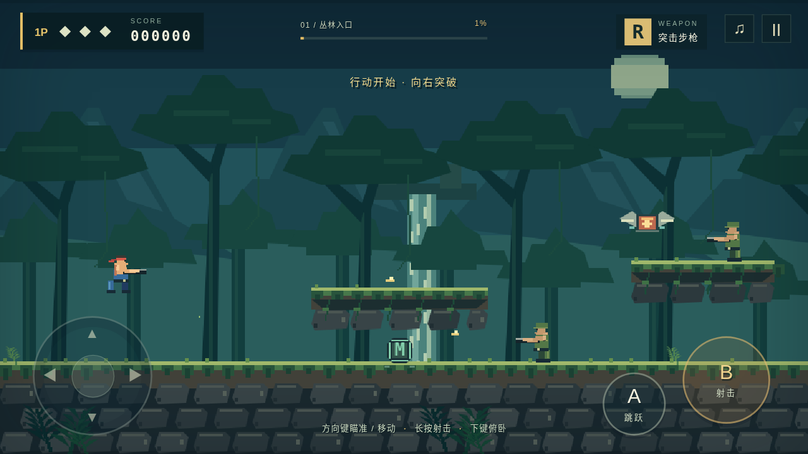

# appgames

Android 离线小游戏项目。

## 丛林突击 · 第一关 v1.1

基于经典跑跳射击玩法制作的原创像素游戏，支持 Android 8.0 及以上，横屏、单人、离线游玩。

- [项目源码与操作说明](jungle-assault/README.md)
- [下载安卓 APK](jungle-assault/dist/JungleAssault-Level1.apk?raw=true)
- [版本记录](CHANGELOG.md)
- [APK SHA-256 校验](jungle-assault/dist/JungleAssault-Level1.apk.sha256)

包含八方向射击、俯卧、散弹/机枪/激光、爆破桥、涉水、敌军炮台及关底核心战。v1.1 支持射击击落敌弹，降低弹幕密度，重做基地 Boss 并放大下方弱点。支持导入本地原声音乐，未导入时保留游戏音效。

首次构建请进入 `jungle-assault/`，按项目说明下载工具链并生成 APK。源码包含玩法与浏览器验证脚本；当前版本已通过自动测试及 APK 签名验证，尚未进行安卓真机测试。
