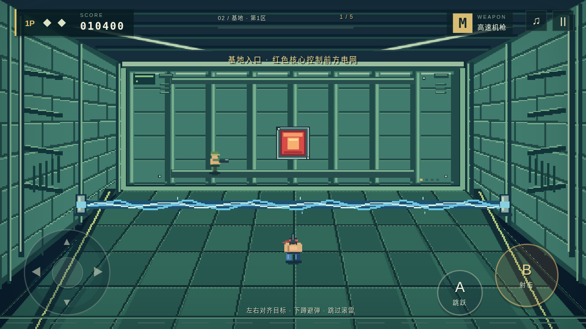
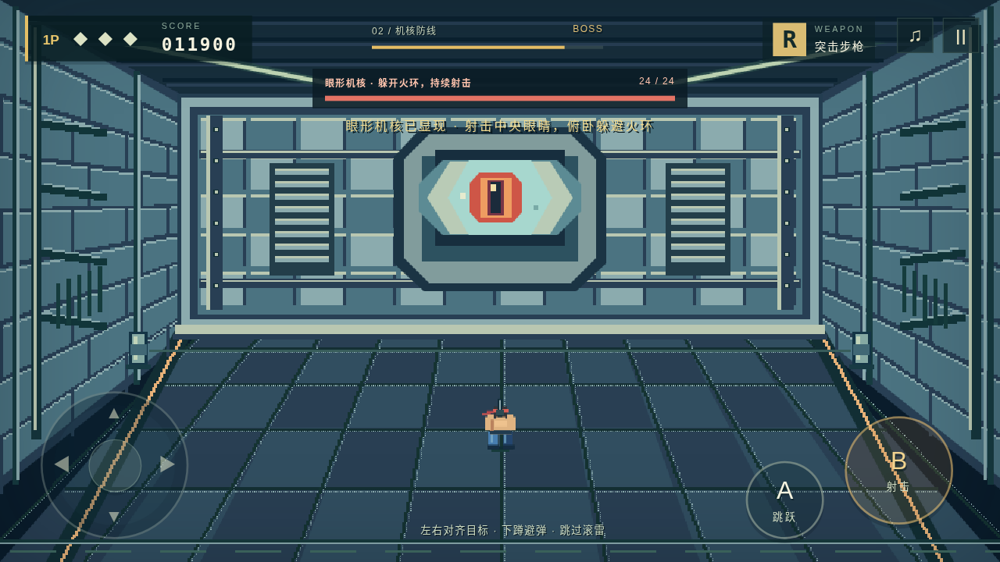

# 丛林突击 · 双关卡战役 v1.2

Android 单人横屏跑跳射击游戏，按 FC／NES《魂斗罗》前两关的主要元素制作。第一关为横向丛林，第二关为纵深基地。画面、关卡数据与合成音效由本项目实现。

## 安装与开始

安装 [JungleAssault.apk](dist/JungleAssault.apk?raw=true)，支持 Android 8.0（API 26）及以上。应用包名为 `com.arcade.jungleassault`，版本为 1.2 / code 3；仓库提供的包与 v1.1 使用同一测试签名，可覆盖升级。游戏离线运行，无广告，不申请联网或存储权限。

标题界面可选择「01 丛林前线」或「02 基地渗透」直接开始。第一关完成后选择「进入第二关」，会带入剩余生命、武器、得分及累计战绩；直接选择第二关则从新开局开始。经典模式 3 命，练习模式 8 命；生命耗尽可从本关检查点继续，扣除 2,000 分。

主安装包名为 `JungleAssault.apk`。旧名 `JungleAssault-Level1.apk` 保留为同字节副本，以兼容之前的下载链接，两份均包含前两关。

## 操作

| 操作 | 触屏 | 键盘预览 |
| --- | --- | --- |
| 左右移动 | 左侧方向盘 | 左右方向键 / A、D |
| 射击 | 长按 B | J / Z |
| 跳跃 | A | K / X / 空格 |
| 俯卧或蹲伏 | 下方向 | 下方向键 / S |
| 第一关八方向瞄准 | 方向盘 | 方向键 / WASD |
| 第一关下穿薄平台 | 下 + A | 下 + 跳跃 |
| 第二关过门前进 | 清除门核后按上 | 上方向键 / W |
| 暂停 | 右上角暂停 / 安卓返回键 | Esc / P |

支持移动、跳跃、射击同时操作。后台自动暂停，回到游戏后手动继续。暂停菜单的「重开本关」会从当前关的新开局重新开始；「检查点继续」保留当前房间或检查点的推进情况。

## 第一关：丛林前线

- 横向卷轴、分层平台、踩踏后爆破的木桥、可涉水的河流与检查点。
- 跑动、翻滚跳跃、八方向射击、俯卧缩小受击框、薄平台下穿。
- 步枪 R、机枪 M、五路散弹 S、穿透激光 L；飞行补给与 B 无敌屏障。
- 跑兵、枪手、炮台与投弹兵；玩家射击可抵消敌弹并击落榴弹，激光可连续穿透击落。
- 基地关底双炮口交替单发，底部红色核心始终可攻击，可在地面水平射击命中。

## 第二关：基地渗透

- 五个纵深走廊与一个独立关底房间。左右移动对齐目标，向基地深处射击。
- 红色门核控制高压电网；摧毁当前房间所有门核后，电网关闭，按住上方向推进至下一室。未清门时碰电网会暂时麻痹、停射，不会直接扣命。
- 蹲伏时仍可射击，可避开高处来弹；地面滚雷需要射落、侧移避开或跳过。
- 横穿守卫、红色补给兵、墙面炮口与不同位置的门核。击败补给兵后，道具会向玩家靠近。
- 关底第一阶段为两门开合炮口与四枚红色传感器；清除后出现眼形机核，发射少量火环。摧毁机核后结算第二关。
- 死亡会失去强化武器，复活提供短暂无敌；耗尽生命后可在当前房间继续，不必重打整个基地。





## FC／NES 原声音乐

三个场景可分别导入本机音频，进入场景时自动切换：

| 场景 | 原版曲目 | 试听来源 |
| --- | --- | --- |
| 第一关丛林 | 密林の戦い（メインBGM） / Jungle Battle | [Spotify 官方发行曲目](https://open.spotify.com/track/1Zwv8Sn4WUr7EMqIXLVqfk) |
| 第二关走廊 | 迷路要塞1（3D） / Labyrinth Fortress | [Apple Music 官方发行曲目](https://music.apple.com/jp/song/1450777089) |
| 第二关 Boss | 迷路要塞2（3Dボス） / Base Boss | [Spotify 官方发行曲目](https://open.spotify.com/track/74VPhu9bPeSeTxJrqhiexT) |

上述曲目收录于 Konami Kukeiha Club 的[《魂斗羅 サウンドトラック（FC版）》](https://open.spotify.com/album/5Wxa96cS7EhTGyFaTYciLf)。第二关走廊发行版约 1:42，Boss 约 1:22。

APK 不内置原版音频文件。未导入对应场景音乐时仅播放游戏音效，不会误用其他场景配乐。在标题或暂停菜单选择「音乐」，选中「01 丛林」「02 走廊」或「02 Boss」，再选择本地音频。

支持设备可解码的 MP3、WAV、OGG、M4A 等格式，每首不超过 20 MB；文件保存在本机，下次打开自动恢复。循环播放、静音、暂停恢复及各槽清除独立处理。无效文件不会覆盖已导入音乐。v1.1 的已导入音乐会保留在第一关槽中。

## 构建与预览

`web/` 是 Canvas 游戏，`android/` 是加载内置资源的 Java WebView 壳。无需 Gradle 或 Node 依赖即可构建 APK。构建需要 Linux x86_64、Java 21、keytool、curl、unzip、Python 3。在本游戏目录执行：

```bash
bash android/bootstrap-toolchain.sh
bash android/build.sh
```

首次下载 Android SDK Platform 35、Build Tools 35 与 ECJ 编译器。工具默认保存在 `.toolchain/`，可用 `JUNGLE_TOOLCHAIN` 更改。仓库不包含工具缓存、编译中间文件和签名密钥。首次本地构建会生成 `android/local-test.keystore`，密码为 `android`；请保留它以签署后续本地更新。自行生成的密钥与仓库 APK 不同，替换安装可能需要先卸载。

浏览器预览：

```bash
python3 -m http.server 8080 --directory web
```

打开 `http://localhost:8080`。测试需要 Node.js 20 及以上：

```bash
node tests/engine.test.cjs
node tests/base.test.cjs
node tests/campaign.test.cjs
node tests/audio.test.cjs
```

浏览器流程测试另需 Playwright 和 Chromium：

```bash
npm install --no-save playwright
CHROMIUM_PATH=/path/to/chromium node tests/browser-smoke.cjs
```

未设置 `CHROMIUM_PATH` 时默认使用 `/usr/bin/chromium`；测试占用本地 8765 端口。

## 验证范围

玩法测试覆盖两关的射击与受击、电网、过门、蹲伏、滚雷、补给、死亡/续关、双阶段 Boss，以及跨关生命/武器/分数继承。音频测试覆盖三槽保存恢复、旧数据兼容、切换、静音/暂停、无效文件回滚与异步竞态。

浏览器测试覆盖实际 WAV 解码、三指操作、不同屏幕比例、关卡选择、第一关结算进入第二关、走廊过门、续关、关底两阶段及音乐自动切换。安装包检查包括编译、DEX、APK v2/v3 签名、zipalign、版本信息及内置资源一致性。具体结果见 [build-report.json](dist/build-report.json)。

当前环境没有 Android 真机或模拟器，尚未进行安卓设备实测。

机制参考：[FC 第二关说明](https://strategywiki.org/wiki/Contra_%28NES%29/Stage_2)。本项目按上述关键元素实现，关卡数据、画面及难度为本项目版本。
